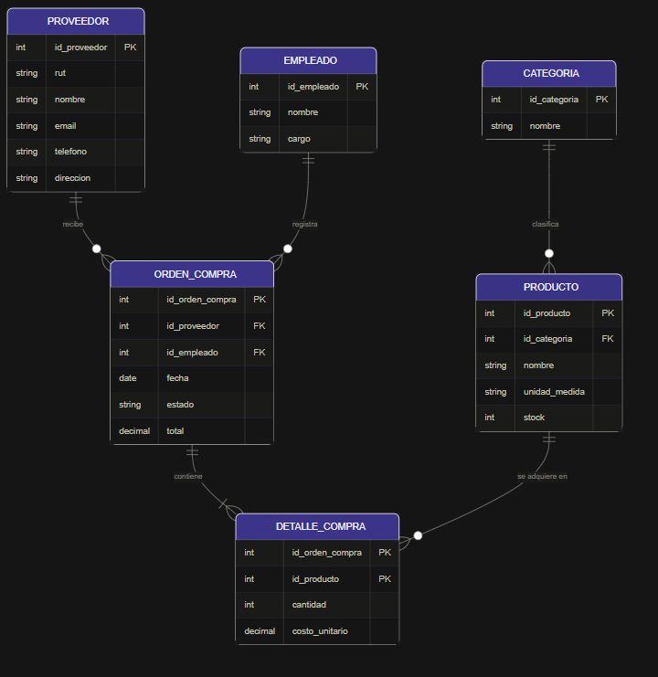

# Módulo Base ERP (Vite + JavaScript Vanilla)

Aplicación mínima de una sola página que sirve como módulo base de software de planificación de recursos empresariales (ERP). Proporciona la base común para construir módulos ERP personalizados: gestión de datos maestros (Entidades) y documentos transaccionales vinculados (Documentos), con crear/editar/eliminar/buscar, validación y persistencia en el `localStorage` del navegador, usando Vite y HTML, CSS y JavaScript vanilla.

La interfaz de usuario está totalmente en **español** (términos predeterminados: Entidad / Documento; nombre del módulo: Módulo Base ERP), incluidas las etiquetas, los mensajes de validación, los estados vacíos y los diálogos.

Las entidades incluyen campos estándar de datos maestros ERP (nombre, código, identificación fiscal, correo, teléfono, dirección, categoría, fecha objetivo, límite de crédito, condiciones de pago). Los documentos usan numeración por serie + folio e incluyen un desglose monetario (subtotal, descuento, impuesto, total), moneda, condiciones de pago, notas, cantidad, fechas y estado.

La aplicación se presenta como un espacio de trabajo ERP coherente:

- **Marco del espacio de trabajo**: cada pantalla vive dentro de un marco con marca: una barra superior con un logotipo (un monograma SVG derivado del nombre del módulo) y el nombre del módulo, más una barra lateral persistente con botones de módulo (Panel, Entidades, Documentos, Búsqueda). El módulo activo se resalta (`aria-current="page"`), y la barra lateral se contrae a una columna de iconos en ventanas estrechas.
- **Panel de inicio**: la pantalla de entrada ofrece botones de acción rápida para las tareas ERP clave (nueva entidad, nuevo documento, abrir las áreas de gestión, buscar registros) y tarjetas de estadísticas en vivo con el número de registros.
- **Tokens de diseño**: el estilo se controla mediante propiedades personalizadas de CSS en `src/styles.css`, de modo que los cambios de marca se aplican globalmente.

## Instalación

Instala las dependencias y ejecuta el servidor de desarrollo:

```bash
npm install
npm run dev
```

Abre http://localhost:5173 (o la URL que imprima Vite).

## Pruebas

Ejecuta la suite completa de pruebas (unitarias + de integración) con:

```bash
npm test
```

O una ejecución única, sin modo watch:

```bash
npx vitest run
```

## Construcción de módulos personalizados

Los módulos ERP personalizados construidos sobre esta base definen:

- Qué representa una **Entidad** (p. ej., cliente, producto, activo) y sus campos específicos del dominio.
- Qué representa un **Documento** (p. ej., pedido, factura, contrato).
- Las etiquetas y reglas de validación propias del módulo.

El módulo base se encarga de la generación de identidad, las marcas de tiempo, la integridad referencial entre entidades y documentos, la eliminación en cascada, la navegación y la búsqueda. Consulta `specs/001-erp-base-module/` para ver la especificación completa.

## Personalización mediante configuración

Toda la personalización vive en un solo lugar: el objeto `userConfig` al inicio de `src/module-config.js`. Los desarrolladores editan esta única exportación; no se requieren cambios en el código central. Opciones disponibles:

- `moduleName`: nombre visible en la barra superior, el panel y el título del documento; también deriva el monograma del logotipo.
- `labels`: renombra los términos Entidad/Documento en todas las pantallas, incluidos los botones de la barra lateral, las acciones rápidas, los formularios y los mensajes. Los artículos y concordancias del español (el/la, seleccionado/a) se derivan de la primera palabra de cada término configurado.
- `customFields`: declara campos adicionales por tipo de registro con `target` (`entity` o `document`), `key`, `label`, `type` (`text`, `number`, `date` o `select`), `required` opcional y `options` para los select. Las claves no deben chocar con los nombres de campos base (ver `specs/001-erp-base-module/data-model.md`). Los valores se persisten junto a los registros y aparecen en los resultados de búsqueda.
- `statusLifecycle`: restringe los estados de los documentos a una lista configurada de `statuses` con `transitions` permitidas entre ellos. Sin él, el estado sigue siendo un campo de texto libre.
- `theme.accentColor`: un color hexadecimal (p. ej., `"#0f62fe"`) aplicado en todo el marco como resaltados y controles principales. Los valores inválidos retroceden al predeterminado.

Si la configuración es inválida (tipos desconocidos, claves incorrectas, transiciones que referencian estados desconocidos, colores de acento no hexadecimales), la aplicación muestra los problemas en un banner y retrocede a los valores predeterminados en lugar de romperse.

## Módulo de Adquisiciones y Compras: Modelo Entidad-Relación (MER)

Esta sección explica, en palabras, el modelo de datos del módulo personalizado de **Adquisiciones y Compras** y cómo funciona sobre el módulo base. El módulo cubre el proceso de comprar bienes a proveedores: a quién se compra, qué se compra, quién registra la compra y cuánto cuesta. Las **ventas** pertenecen a otro módulo distinto y quedan fuera de este modelo.

### Diagrama



*Figura: MER del módulo. En lila, los elementos que vienen del módulo base (Proveedor = Entidad, Orden de compra = Documento); en verde, las extensiones propias del módulo.*

### Las entidades, en palabras

- **Proveedor**: la empresa o persona a quien se le compra. Es el dato maestro del módulo. Tiene un código de negocio y un nombre (ambos obligatorios), además de su identificación fiscal (RUT), correo, teléfono y dirección.
- **Empleado**: la persona de la organización que registra una orden de compra. Guarda su nombre y su cargo.
- **Categoría**: un grupo para organizar los productos (por ejemplo, insumos de oficina o materias primas). Solo tiene un identificador y un nombre.
- **Producto**: el bien que se adquiere. Guarda su nombre, su unidad de medida (unidad, kilo, caja...) y el `stock` disponible. Cada producto pertenece a una categoría.
- **Orden de compra**: el documento transaccional del módulo. Representa un pedido hecho a un proveedor y registrado por un empleado. Se identifica por su folio, tiene una fecha de emisión y una fecha de entrega esperada, un estado (por ejemplo, pendiente o recibido) y un total.
- **Detalle de compra**: cada línea de una orden. Indica qué producto se pide, en qué cantidad y a qué costo unitario. Es la entidad que une las órdenes con los productos.

### Las relaciones y sus cardinalidades

| Relación | Cardinalidad | Cómo se lee |
|---|---|---|
| Proveedor → Orden de compra | 1:N | Un proveedor puede recibir muchas órdenes; cada orden pertenece exactamente a un proveedor. |
| Empleado → Orden de compra | 1:N | Un empleado puede registrar muchas órdenes; cada orden la registra un solo empleado. |
| Orden de compra → Detalle de compra | 1:N (mínimo 1) | Una orden tiene al menos una línea y puede tener varias. |
| Producto → Detalle de compra | 1:N | Un producto puede aparecer en muchas líneas de distintas órdenes. |
| Categoría → Producto | 1:N | Una categoría agrupa muchos productos; cada producto tiene una sola categoría. |

Entre **Orden de compra** y **Producto** existe en realidad una relación de muchos a muchos: una orden incluye varios productos y un producto se compra en varias órdenes. Se resuelve con la entidad intermedia **Detalle de compra**, cuya clave primaria es compuesta: el par (orden, producto) identifica cada línea.

### Cómo se apoya en el módulo base

El módulo base solo conoce dos tipos de registro: **Entidad** y **Documento**. El MER se construye sobre ellos y los amplía donde hace falta.

| En el MER | En el módulo base | Tratamiento |
|---|---|---|
| Proveedor | Entidad | Se usa directamente. Se renombra la etiqueta con `labels`. |
| Orden de compra | Documento | Se usa directamente. Se renombra la etiqueta con `labels` y se controla el estado con `statusLifecycle`. |
| Empleado, Producto y Categoría | Sin equivalente | **Extensión**: son datos maestros adicionales que el base no gestiona. |
| Detalle de compra | Sin equivalente | **Extensión**: el documento base maneja una sola cantidad. La especificación indica que las partidas de documento (líneas con producto, cantidad y precio) son un punto de extensión natural. |

**Correspondencia de campos del Proveedor (Entidad base)**

| Campo del MER | Campo base | Notas |
|---|---|---|
| `entity_id` | `entity_id` | Generado automáticamente y único; es el vínculo con las órdenes. |
| `codigo` | `code` | Obligatorio, no vacío. |
| `nombre` | `name` | Obligatorio, no vacío. |
| `rut` | `taxId` | Opcional; se guarda recortado. |
| `email` | `email` | Opcional; debe tener formato de correo válido. |
| `telefono` | `phone` | Opcional. |
| `direccion` | `address` | Opcional. |

**Correspondencia de campos de la Orden de compra (Documento base)**

| Campo del MER | Campo base | Notas |
|---|---|---|
| `id_orden_compra` | `id` | Generado automáticamente. |
| `entity_id` | `entity_id` | Debe referenciar un proveedor existente. |
| `id_empleado` | Sin equivalente | Vínculo con el empleado; forma parte de la extensión. |
| `folio` | `folio` | Entero positivo obligatorio. |
| `fecha_emision` | `startDate` | Obligatoria, formato `YYYY-MM-DD`. |
| `fecha_entrega` | `endDate` | Obligatoria; igual o posterior a `startDate`. |
| `estado` | `status` | Texto libre, o controlado por `statusLifecycle`. |
| `total` | `totalAmount` | Número no negativo. |

El módulo base ofrece además campos opcionales que este MER no modela, pero que pueden incorporarse si el proceso de compras los necesita: en la entidad, `category`, `description`, `targetDate`, `creditLimit` y `paymentTerms`; en el documento, `series`, `subtotal`, `discount`, `taxAmount`, `currency`, `paymentTerms`, `notes` y `quantity`.

### Cómo funciona el flujo de compra

1. **Se configura el módulo**: en `userConfig` se define el nombre del módulo, se renombran Entidad → Proveedor y Documento → Orden de Compra, y se declara el ciclo de vida de estados.
2. **Se registran los datos maestros**: proveedores (con nombre y código obligatorios), empleados, y las categorías y productos del catálogo.
3. **Se crea una orden de compra**: se elige el proveedor, se indica qué empleado la registra, el folio, la fecha de emisión y la fecha de entrega esperada. El sistema impide guardar si falta el proveedor, el folio o las fechas, o si la fecha de entrega es anterior a la de emisión.
4. **Se agregan las líneas de detalle**: por cada producto se indica la cantidad y el costo unitario. El costo se guarda en la propia línea, de modo que el precio pagado queda como registro histórico aunque después cambie.
5. **Se calcula el total**: es la suma de cantidad × costo unitario de las líneas. El módulo base valida cada importe por separado, pero no calcula el total automáticamente; esa regla es un punto de extensión que este módulo debe implementar. Si se incorporan `subtotal`, `discount` y `taxAmount`, el total sería `subtotal − descuento + impuesto`.
6. **La orden avanza de estado**: con un ciclo de vida configurado, solo se ofrecen las transiciones permitidas y cualquier transición inválida se rechaza con una explicación.
7. **Al recibir la mercadería**, el `stock` de cada producto de la orden aumenta según la cantidad recibida (regla de la extensión).
8. **Integridad de los datos**: si se elimina un proveedor, el módulo base elimina en cascada todas sus órdenes de compra.

### Configuración sugerida

Ejemplo de `userConfig` para este módulo (los valores son una propuesta; ajustar a los requisitos reales):

```js
export const userConfig = {
  moduleName: "Adquisiciones y Compras",
  labels: {
    entity: "Proveedor",
    entities: "Proveedores",
    document: "Orden de Compra",
    documents: "Órdenes de Compra",
  },
  statusLifecycle: {
    statuses: ["borrador", "pendiente", "aprobado", "recibido", "cancelado"],
    transitions: {
      borrador: ["pendiente", "cancelado"],
      pendiente: ["aprobado", "cancelado"],
      aprobado: ["recibido", "cancelado"],
      recibido: [],
      cancelado: [],
    },
  },
  theme: { accentColor: "#0f62fe" },
};
```

Este ejemplo no declara `customFields`, porque todos los campos del MER son campos base o pertenecen a la extensión. Las claves reservadas de los campos base están listadas en `specs/001-erp-base-module/data-model.md`.

### Decisiones de diseño

- **El total es un dato derivado**: debe coincidir siempre con la suma de las líneas de la orden.
- **El costo unitario vive en el detalle**: conserva el precio histórico de cada compra.
- **Empleado es una extensión**: el módulo base no gestiona empleados, por lo que se trata como un dato maestro adicional del módulo, igual que productos y categorías.
- **Producto es compartido con otros módulos**: el módulo de ventas también necesitará productos, por lo que conviene reutilizar una sola definición.
- **Unicidad de folio por serie**: el módulo base no la garantiza; es un punto de extensión si se requiere.

### Página de visualización del módulo

La página muestra los datos del módulo leyéndolos del `localStorage` (`erp_base_module:entities` y `erp_base_module:documents`). Propuesta de contenido:

- **Con los datos base** (proveedores y órdenes): gasto total por proveedor (suma de `totalAmount` agrupada por `entity_id`), compras por mes (según `startDate`), órdenes por estado y órdenes con entrega próxima o vencida (según `endDate`).
- **Con la extensión** (empleados, líneas, productos y categorías): compras por empleado, productos más comprados y su costo promedio, y stock actual por categoría.

Consideraciones técnicas:

- La especificación exige **sanitizar** todo contenido introducido por el usuario antes de renderizarlo en el DOM (escapar HTML y atributos de eventos) para prevenir ataques XSS. La página de visualización debe cumplirlo al mostrar nombres de proveedores y de empleados.
- El panel y las listas deben seguir siendo ágiles con al menos 500 registros de entidad.
- Las estadísticas deben coincidir siempre con los datos almacenados.

## Notas

- Los datos se persisten en `localStorage` bajo las claves `erp_base_module:entities` y `erp_base_module:documents`.
- Eliminar una entidad también elimina sus documentos (cascada).
- Este proyecto usa intencionadamente HTML, CSS y JavaScript vanilla por simplicidad.
